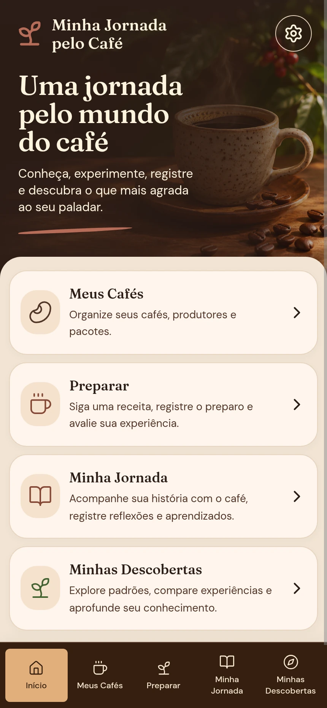
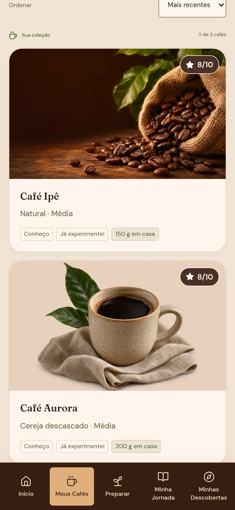
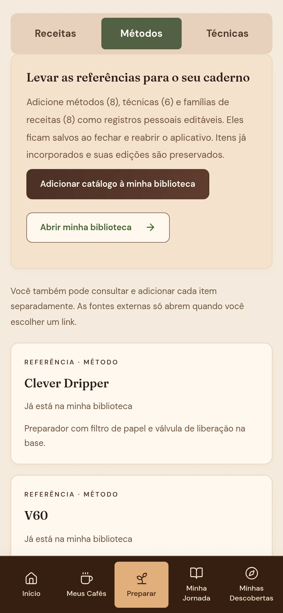
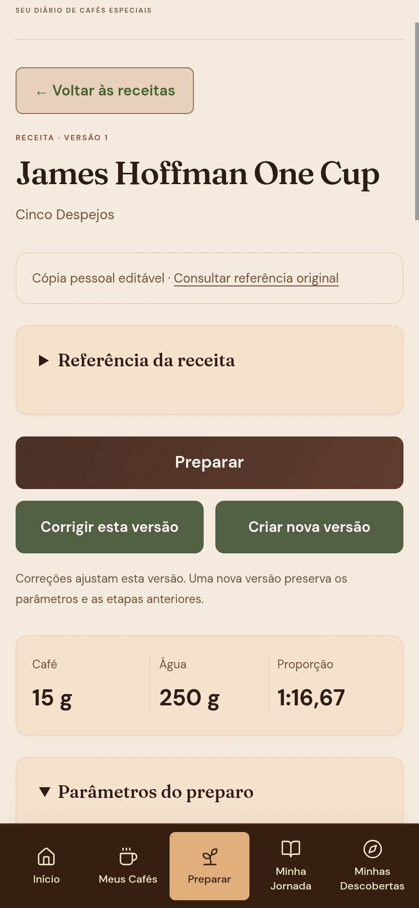
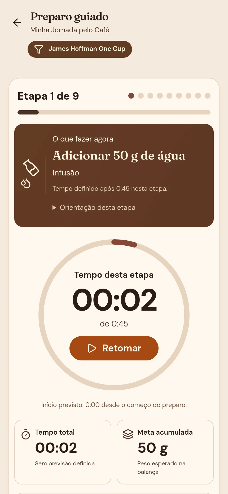
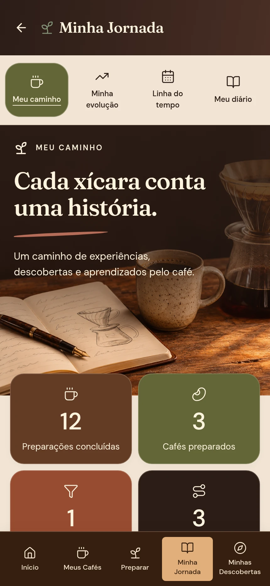
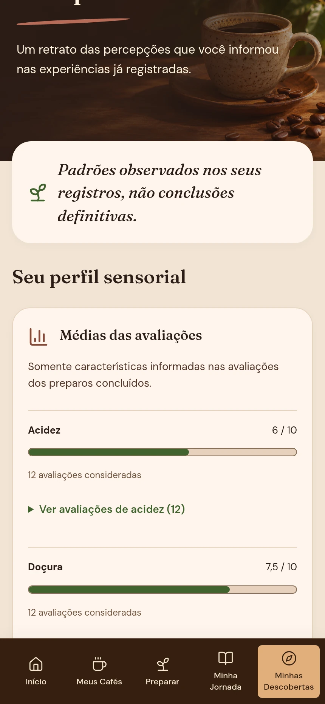

# Minha Jornada pelo Café

**Um espaço pessoal para conhecer, preparar, experimentar e aprender sobre cafés especiais.**

Minha Jornada pelo Café reúne a coleção de cafés, as receitas e as experiências de preparo em um só lugar. Foi desenvolvido para ajudar quem aprecia café a guardar o que experimentou, reconhecer preferências e construir seu próprio repertório — do primeiro método aos ajustes de uma receita favorita.

**Versão 1.0.0 em preparação para distribuição no Google Play.**

[Conheça o aplicativo](#conheça-o-aplicativo) · [Como funciona](#como-funciona) · [Desenvolvimento](#desenvolvimento) · [Política de Privacidade](https://daniloqb.github.io/JornadaCafe/politica-de-privacidade.html)

## Por que Minha Jornada pelo Café?

Um café muda conforme a origem e as características dos grãos, o método, a técnica, a moagem, a proporção de água, a temperatura, o tempo e os despejos. As percepções sensoriais também fazem parte dessa experiência. Depois de algumas semanas, pode ser difícil lembrar qual combinação trouxe aquele resultado que você gostaria de repetir.

O aplicativo ajuda a transformar essas experiências em registros que você pode revisitar:

- **Organização:** reúna cafés, produtores, origens, pacotes, métodos, técnicas e receitas.
- **Consistência:** guarde os parâmetros e as etapas para repetir um preparo ou ajustar a próxima xícara.
- **Aprendizado:** compare resultados, escreva suas observações e reconheça preferências ao longo do tempo.

Cada pessoa desenvolve seu próprio caminho. Os registros oferecem pistas para novas experiências, sem impor um único jeito de preparar ou apreciar café.

## Conheça o aplicativo

Capturas reais da versão web em tela de smartphone, com dados fictícios em um perfil de demonstração isolado. As imagens dos cafés usam ilustrações já presentes no aplicativo; nenhum registro ou fotografia privada do responsável foi utilizado. Abra as imagens para vê-las em tamanho completo.

| Início | Meus Cafés |
| :---: | :---: |
| <a href="assets/readme/inicio.webp"></a> | <a href="assets/readme/meus-cafes.webp"></a> |
| Um ponto de partida para o próximo café. | Coleção, imagens e estoque no mesmo lugar. |

| Explorar Biblioteca | Receitas | Preparo guiado |
| :---: | :---: | :---: |
| <a href="assets/readme/explorar-biblioteca.webp"></a> | <a href="assets/readme/receitas.webp"></a> | <a href="assets/readme/preparo-guiado.webp"></a> |
| Referências para explorar e incorporar. | Parâmetros e versões para experimentar. | Etapas e tempo acompanhando o preparo. |

| Minha Jornada | Minhas Descobertas |
| :---: | :---: |
| <a href="assets/readme/minha-jornada.webp"></a> | <a href="assets/readme/minhas-descobertas.webp"></a> |
| Uma história construída com suas experiências. | Percepções que ajudam a formular novas perguntas. |

[Origem e detalhes das capturas](assets/readme/README.md).

## Principais funcionalidades

### Início

Uma visão de entrada com atalhos para a coleção, o próximo preparo, a jornada e as descobertas. Também dá acesso às Configurações, aos temas, ao tamanho do texto e aos recursos de backup.

### Meus Cafés

Cadastre cafés, produtores e origens, acrescente fotografias e organize sua coleção. Registre os pacotes, acompanhe o estoque disponível e consulte o histórico relacionado a cada café.

### Preparar

Organize métodos, técnicas e receitas com seus parâmetros, etapas, fotografias opcionais e referências. Crie versões pessoais, explore a biblioteca que acompanha o aplicativo e use o preparo guiado para acompanhar as etapas e o cronômetro. Ao concluir, registre o resultado e sua avaliação.

A biblioteca padrão pode ser consultada offline no Android. Referências para vídeos e páginas externas precisam de conexão quando abertas.

### Minha Jornada

Revisite os preparos em ordem cronológica, acompanhe sua evolução e mantenha um diário de reflexões e aprendizados. Experiências e anotações ajudam a lembrar tanto do resultado quanto das perguntas que surgiram durante o caminho.

### Minhas Descobertas

Consulte seu perfil sensorial, compare preparos do mesmo café e observe padrões nos registros. Reúna observações, hipóteses e aprendizados para identificar preferências. As comparações descrevem o que você registrou; não comprovam relações de causa e efeito nem conclusões científicas.

## Como funciona?

1. Conheça um café, adicione-o à coleção e registre seu pacote, se desejar acompanhar o estoque.
2. Escolha um método, uma técnica e uma receita da biblioteca ou crie sua própria combinação.
3. Revise os parâmetros e siga o preparo guiado, acompanhando as etapas e o tempo.
4. Registre sua avaliação, suas percepções e o que gostaria de ajustar.
5. Consulte o histórico e compare as experiências.
6. Reconheça suas preferências e leve seus aprendizados para a próxima xícara.

## Explore, aprenda e personalize

O aplicativo acompanha uma biblioteca inicial consolidada a partir de experiências reais de estudo e preparo: **8 métodos, 6 técnicas e 8 famílias de receitas** na versão atual do catálogo.

Em **Preparar → Explorar biblioteca**, consulte os métodos, conheça as técnicas e veja receitas com parâmetros e etapas. Você pode adicionar os itens à sua biblioteca pessoal, adaptar quantidades, registrar referências e criar novas versões.

A biblioteca de referência permanece independente da coleção pessoal. Adicionar uma referência cria uma cópia editável; seus cafés, estoque e histórico seguem separados. Créditos e links são preservados quando disponíveis. As receitas são referências de estudo e experimentação, sem representar necessariamente versões oficiais aprovadas por seus criadores.

Para manter o catálogo padrão do projeto, consulte o [procedimento de atualização da biblioteca](docs/phase-07.3.md).

## Seus registros, sob seu controle

O aplicativo foi concebido para uso pessoal com armazenamento local, sem exigir conta ou sincronização automática em nuvem. No Android, os registros ficam em SQLite e as imagens em arquivos privados; na web, os dados ficam no IndexedDB do navegador.

Em **Configurações → Dados, backup e compartilhamento**, há dois recursos com finalidades diferentes:

- **Backup pessoal:** exporta a jornada completa, incluindo registros, preferências e fotografias, para restauração posterior. Guarde uma cópia fora do aplicativo. A restauração substitui os dados locais após confirmação.
- **Compartilhamento de biblioteca:** exporta métodos, técnicas e receitas selecionados, com imagens opcionais das receitas. Não transfere automaticamente cafés pessoais, estoque, preparações, avaliações ou reflexões. Revise os textos e imagens escolhidos antes de compartilhar.

**Os arquivos ZIP pessoais não possuem criptografia própria.** Guarde-os em um local de confiança. Você escolhe quando salvar ou compartilhar os arquivos e quais aplicativos receberão as cópias; esses serviços e os sites externos seguem suas próprias políticas.

Na web, a persistência depende do navegador e de seus dados locais. A versão atual não promete recarregar o site sem conexão como um aplicativo PWA instalado.

## Privacidade

A política explica os dados locais, fotografias, exportações, permissões, retenção, exclusão, medidas de segurança e direitos relacionados à LGPD, considerando os limites reais do aplicativo. Ela também está disponível nas Configurações, com uma cópia local para leitura offline no Android.

- [Política de Privacidade publicada](https://daniloqb.github.io/JornadaCafe/politica-de-privacidade.html).
- [HTML da política no repositório](docs/politica-de-privacidade.html).
- [Manutenção e publicação por GitHub Pages](docs/play-store/PRIVACIDADE_E_GITHUB_PAGES.md).

Responsável: **Danilo Queiroz Barbosa** · Privacidade e suporte: **daniloqb@gmail.com**.

## Tecnologias

- **React e TypeScript:** interface e regras da aplicação.
- **Vite e Tailwind CSS:** desenvolvimento, build e estilos.
- **Capacitor Android:** integração da interface web com o aplicativo Android e os recursos nativos.
- **SQLite:** persistência dos registros no Android, por meio de `@capacitor-community/sqlite`.
- **IndexedDB:** persistência local na versão web.
- **Capacitor Filesystem e plugin nativo DataFiles:** arquivos privados e fluxos de importação, exportação e compartilhamento no Android.
- **Vitest:** testes automatizados das regras e do armazenamento.

## Desenvolvimento

### Pré-requisitos

Para a versão web: **Node.js 22.12 ou superior** e npm. Para Android: **JDK 21**, Android Studio e SDK Android com plataforma **36**, além de um aparelho ou emulador configurado. O projeto usa SDK mínimo 24 e alvo/compilação 36.

Instale as dependências e inicie o servidor local:

```bash
npm ci
npm run dev
```

Abra a URL exibida no terminal, normalmente `http://127.0.0.1:5173`.

Verifique os tipos, execute os testes e gere o build web:

```bash
npm run typecheck
npm test
npm run build
```

A saída web fica em `dist/`. Para conferi-la localmente, use `npm run preview`.

### Desenvolvimento Android

```bash
# Compila a interface e sincroniza os assets/plugins com o Android.
npm run android:sync

# Abre o projeto nativo no Android Studio.
npm run android:open

# Sincroniza e executa no aparelho ou emulador selecionado.
npm run android:run
```

Os comandos acima são de desenvolvimento. Antes de trocar uma instalação com registros importantes, confira o backup pessoal e a compatibilidade de assinatura conforme o [guia Android](docs/RELEASE_ANDROID.md).

## Versão Android

**Versão: 1.0.0 · versionCode: 19 · applicationId: `br.com.jornadacafe.app`.**

Versão 1.0.0 em preparação para distribuição no Google Play. O link da loja será acrescentado após a publicação oficial.

O projeto possui um processo automatizado para gerar APK e AAB assinados, verificar os pacotes e organizar hashes e relatório em `release/`. A chave própria e as credenciais devem estar configuradas externamente; não há assinatura debug como alternativa para release.

Depois de seguir os requisitos do [guia de release Android](docs/RELEASE_ANDROID.md):

```bash
npm run release:check
npm run build:release -- --version-name 1.0.0 --version-code 19
```

Antes de cada distribuição, confirme que o código ainda não foi usado no Play Console. A assinatura, os testes do pacote final e a submissão à loja são etapas distintas da preparação do projeto.

Os detalhes técnicos e as pendências estão no [relatório da Fase 08](docs/phase-08.md) e nos [materiais para o Google Play](docs/play-store/loja.md).
